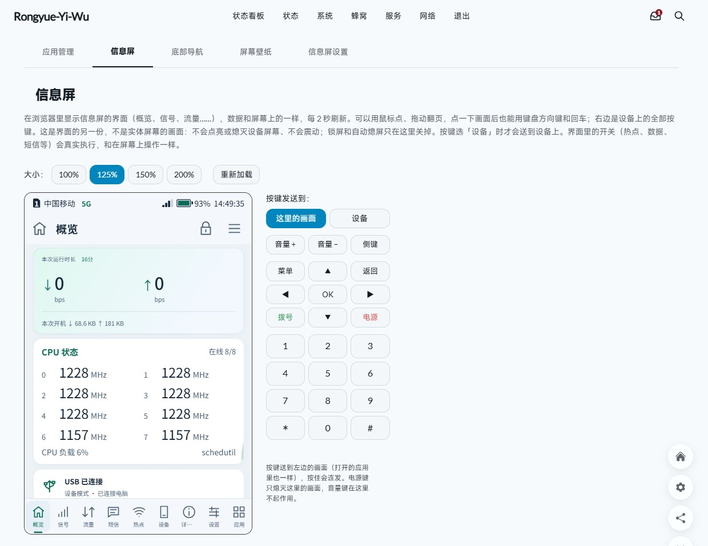
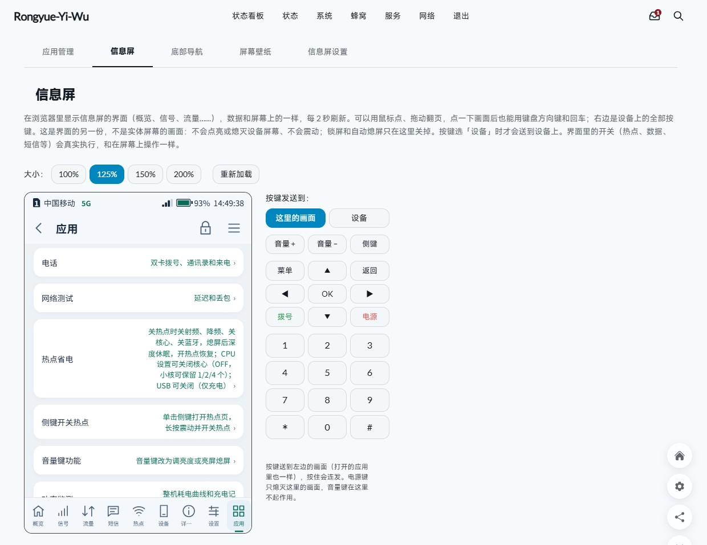
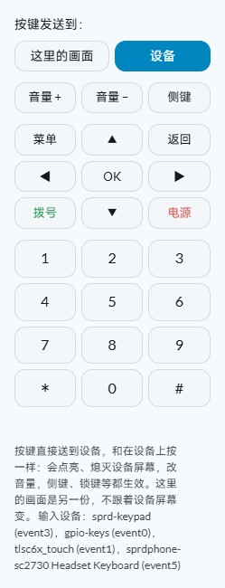
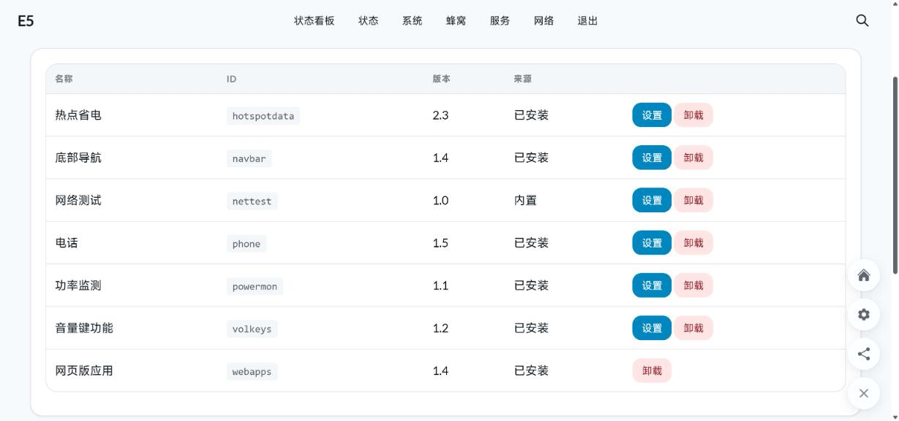
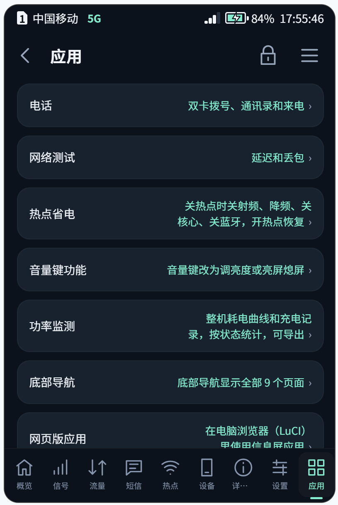

# 网页版应用 · Apps on the Web

在电脑浏览器（LuCI）里使用信息屏应用

*Use the screen's apps in a browser (LuCI)*

容悦 E5（OpenWrt）信息屏应用。当前版本 **v1.6**，应用 ID `webapps`。

## 截图

LuCI：服务 → 信息屏应用 →「信息屏」标签，在浏览器里显示和操作信息屏界面。

画面右边是设备上的全部按键（音量 +/−、侧键、菜单、方向、OK、返回、拨号、电源、0–9、*、#），按住即长按。「按键发送到」可选：

- **这里的画面**：按键送到网页里的画面（打开的应用里也一样），按住会连发；不影响设备。
- **设备**：写入设备的输入设备（`/dev/input/eventN`，按 `/proc/bus/input/devices` 找到对应的键），和在设备上按一样：会点亮、熄灭设备屏幕、改音量，侧键长按、锁键（电源后按 *）等都生效。设备没有的键显示为灰色。

在右边按「菜单」：网页里的画面打开应用列表，和在设备上按菜单键一样。

「设备」模式：按键直接送到设备，下面列出设备的输入设备。

「应用管理」标签：已安装的应用、版本，以及设置和卸载。

设备屏幕上的「应用」页。

## 安装

1. 下载 [`releases/webapps-v1.6.tar.gz`](releases/webapps-v1.6.tar.gz)。
2. 在信息屏的「应用管理」中安装（LuCI：服务 → 信息屏应用 → 应用管理）。
3. 安装后文件位于设备上的 `/etc/e5-infoscreen/plugins/webapps/`。

## 源码

`webapps/` 是当前版本安装包解压后的内容：

- [`backend.uc`](webapps/backend.uc)
- [`e5-apps.cgi`](webapps/e5-apps.cgi)
- [`index.html`](webapps/index.html)
- [`luci/apps.js`](webapps/luci/apps.js)
- [`luci/menu.json`](webapps/luci/menu.json)
- [`luci/screen.js`](webapps/luci/screen.js)
- [`manifest.json`](webapps/manifest.json)

## 版本

- [v1.6](releases/webapps-v1.6.tar.gz)（当前）：按键区排版修正（「设备」按钮不再换行，* 键字号与数字一致）
- [v1.5](releases/webapps-v1.5.tar.gz)：「信息屏」标签旁加模拟按键
- [v1.4](releases/webapps-v1.4.tar.gz)
- [v1.3](releases/webapps-v1.3.tar.gz)
- [v1.2](releases/webapps-v1.2.tar.gz)
- [v1.1](releases/webapps-v1.1.tar.gz)
- [v1.0](releases/webapps-v1.0.tar.gz)
